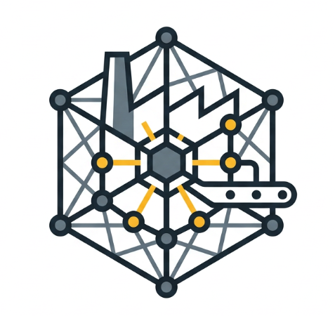
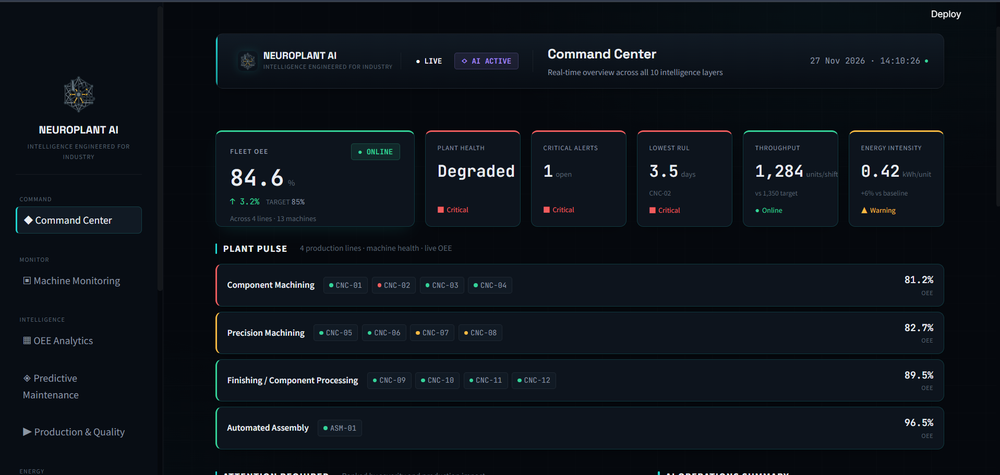
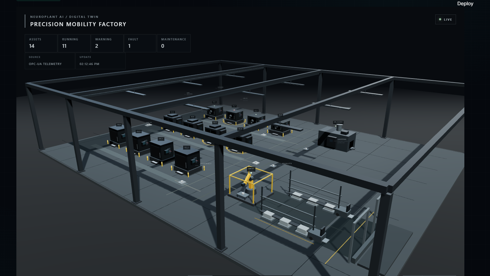
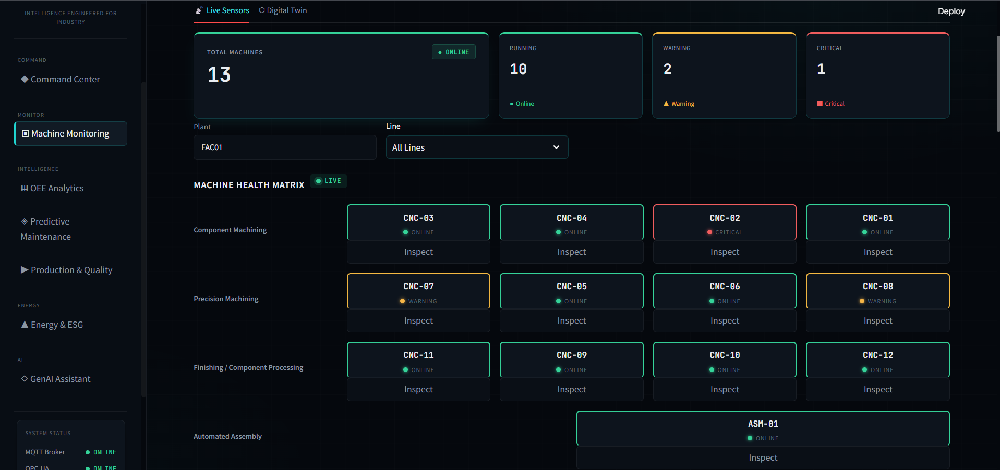
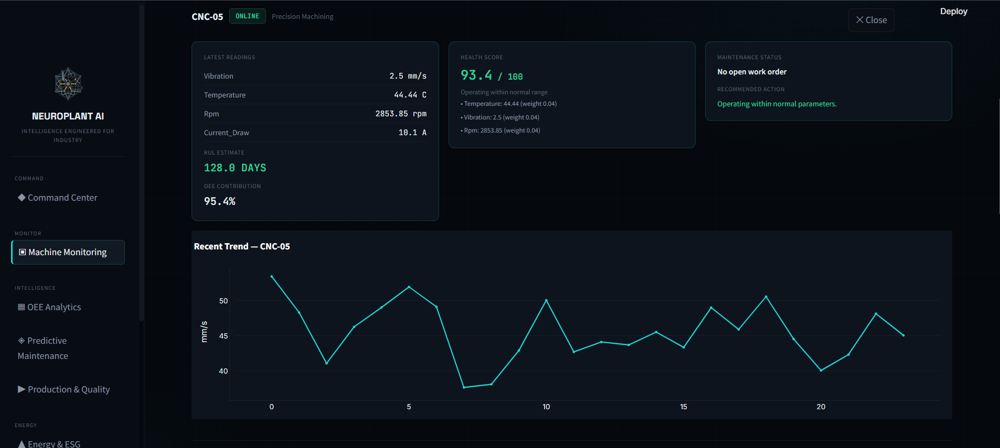
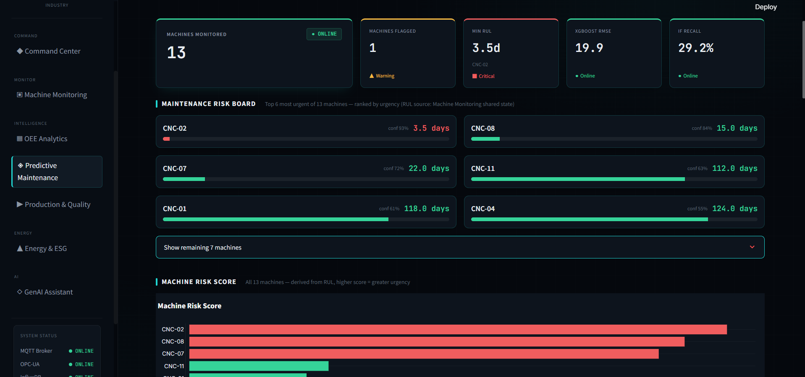
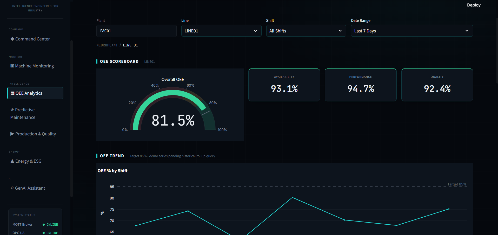
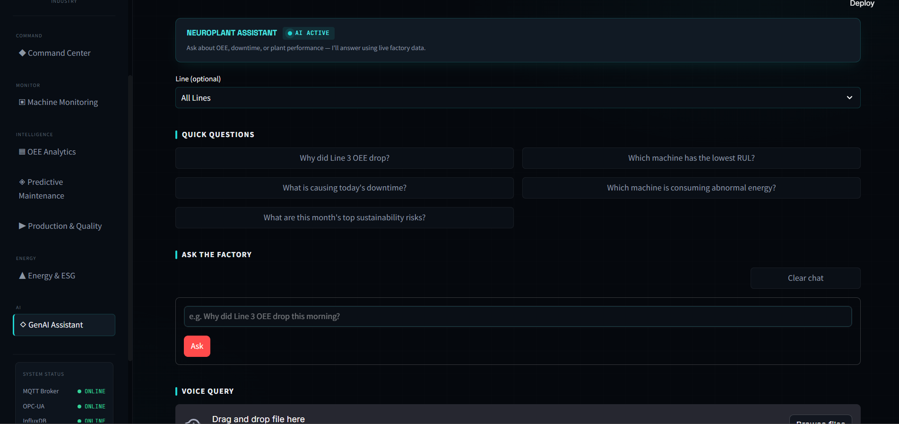

<div align="center">



# NeuroPlant AI

### Industrial AI and Predictive Maintenance Platform

Real-time monitoring · OEE analytics · Predictive maintenance · 3D digital twin · Production optimisation · Energy intelligence · Quality intelligence · GenAI factory assistant


</div>

---

## Overview

**NeuroPlant AI** is an end-to-end Industry 4.0 platform that monitors, predicts, optimises and explains the operations of a **simulated precision automotive drivetrain factory.**.

It replicates the intelligence layer of a modern smart factory: machine telemetry arrives over **MQTT and OPC-UA**, is stored in a time-series database, and feeds ten analytics layers covering OEE, predictive maintenance, digital twin simulation, production optimisation, energy, quality, sustainability and a natural-language **GenAI assistant**.

> **Note:** All machine data is generated by a synthetic sensor generator with fault injection, and ML models are trained and benchmarked on public datasets (NASA CMAPSS, CWRU, AI4I 2020).

### The simulated plant

| Item | Details |
|---|---|
| Plant | NeuroPlant-AI, precision automotive drivetrain components |
| Production lines | 3 (`LINE01`, `LINE02`, `LINE03`) |
| CNC machines | 12 (`CNC-01` to `CNC-12`, e.g. `CNC-07` = Gear Shaft) |
| Assembly | 1 assembly robot (`ASM-01`) plus supporting zones |
| Total assets in digital twin | 19 (12 CNC + 7 support) |
| Source of truth | `config/plant_topology.json` defines all machines, lines and sensors |

---

## Key Features

| Area | What it does |
|---|---|
| **IIoT ingestion** | MQTT publisher/subscriber and OPC-UA server/client streaming synthetic multi-sensor data with fault injection into InfluxDB |
| **Real-time monitoring** | Live machine status, sensor trends and alarms in the Streamlit app, with Grafana provisioning for InfluxDB dashboards |
| **OEE analytics** | Availability × Performance × Quality per line and shift, downtime classification, SKU-wise ideal cycle times |
| **Predictive maintenance** | Remaining Useful Life with XGBoost, LSTM and TFT, FFT bearing-fault detection, Isolation Forest vs Z-score anomaly benchmark, SHAP explanations, work orders |
| **Digital twin** | Interactive 3D factory (React Three Fiber) with live state, machine inspector, and failure/maintenance scenario simulation |
| **Production optimiser** | Bottleneck detection, line balancing, shift scheduling via SciPy linear programming |
| **Energy intelligence** | Electricity, compressed air, water and steam monitoring, energy anomaly detection, carbon-emission estimation |
| **Quality intelligence** | Quality KPIs, fault classification and SHAP-based contrastive explanations per fault |
| **Sustainability / ESG** | ESG report generation from energy and carbon data |
| **GenAI assistant** | LangChain + Google Gemini assistant answering plant questions; falls back to an offline summary if Gemini is unavailable |
| **PDF reporting** | Shift, executive and ESG reports generated as PDFs with fpdf2 |
| **MLOps** | MLflow experiment tracking and model registry, retraining pipeline module |

---

## System Architecture

```
 Synthetic sensors (fault injection)
        │  MQTT  /  OPC-UA
        ▼
 ┌──────────────────────────────────────────────┐
 │ Layer 1  Ingestion  ──►  InfluxDB / Redis    │
 └──────────────────────────────────────────────┘
        │
        ▼
 Layer 2  Monitoring     Layer 3  OEE Analytics
 Layer 4  Predictive Maintenance (RUL, FFT, anomaly, SHAP)
 Layer 5  Digital Twin   Layer 6  Production Optimiser
 Layer 7  Energy         Layer 8  Quality Intelligence
 Layer 9  Sustainability Layer 10 GenAI Assistant
        │
        ▼
 FastAPI (REST)  ◄──►  PostgreSQL (SQLAlchemy)
        │
        ├── Streamlit dashboard (7 pages)
        ├── React + Three.js digital twin (embedded in Streamlit)
        └── Grafana (InfluxDB data source)
```

The editable diagram is in [`docs/architecture_diagram.drawio`](docs/architecture_diagram.drawio).

### The 10 layers

| # | Layer | Folder | Highlights |
|---|---|---|---|
| 1 | Data ingestion | `src/layer1_ingestion` | MQTT, OPC-UA, InfluxDB writer, synthetic sensor generator |
| 2 | Monitoring | `src/layer2_monitoring` | Grafana datasource and dashboard provisioning |
| 3 | OEE analytics | `src/layer3_oee` | OEE calculator, downtime classifier, models |
| 4 | Predictive maintenance | `src/layer4_predictive_maintenance` | XGBoost, LSTM, TFT, FFT, Isolation Forest, Z-score, SHAP, model registry, work orders |
| 5 | Digital twin | `src/layer5_digital_twin` | Twin state, production simulator, downtime impact calculator |
| 6 | Production optimiser | `src/layer6_production_optimizer` | Bottleneck detector, line balancing, LP shift scheduler |
| 7 | Energy intelligence | `src/layer7_energy_intelligence` | Electricity, compressed air, water/steam, carbon, anomaly detection |
| 8 | Quality intelligence | `src/layer8_quality_intelligence` | Quality KPIs, fault classifier, SHAP contrastive explainer |
| 9 | Sustainability | `src/layer9_sustainability` | ESG report generator |
| 10 | GenAI assistant | `src/layer10_genai_assistant` | LangChain agent, query router, shift and executive report generators |

Supporting modules: `src/mlops` (MLflow tracking, retraining), `src/notifications` (push service), `src/observability` (Prometheus metrics), `src/api` (FastAPI app and routers).

---

## Machine Learning and Analytics

| Task | Methods | Data |
|---|---|---|
| Remaining Useful Life | XGBoost, LSTM, Temporal Fusion Transformer, compared with a benchmark script | NASA CMAPSS turbofan |
| Bearing fault detection | FFT frequency-band energy analysis | CWRU bearing dataset |
| Anomaly detection | Isolation Forest vs rolling Z-score benchmark | AI4I 2020 |
| Explainability | SHAP for RUL drivers and per-fault contrastive explanations | Model outputs |
| Optimisation | SciPy linear programming for shift scheduling and line balancing | Plant topology and OEE data |
| Experiment tracking | MLflow runs and model registry | All trained models |

Benchmark code lives in `src/layer4_predictive_maintenance/model_benchmark.py` and `anomaly_benchmark.py`. Run them to reproduce results on your machine.

---

## Dashboard

The Streamlit app has **7 pages**:

| Page | Content |
|---|---|
| Home | Plant overview and KPIs |
| Machine Monitoring | Live machine status and sensors, with the embedded 3D digital twin |
| OEE Analytics | OEE and its Availability, Performance and Quality components by line and shift |
| Predictive Maintenance | RUL, anomaly and bearing-fault results, SHAP explanations |
| Production and Quality | Production optimiser and quality fault intelligence |
| Energy and Sustainability | Utility consumption, carbon estimates, ESG reporting |
| GenAI Assistant | Chat interface with persistent history and report generation |

### Screenshots

| Command Center | 3D Digital Twin |
|---|---|
|  |  |

| Machine Monitoring | Failure Scenario Simulation |
|---|---|
|  |  |

| Predictive Maintenance | OEE Analytics |
|---|---|
|  |  |

**GenAI Assistant**



### 3D digital twin

Built with React, React Three Fiber and Three.js, bundled with Vite, and embedded into Streamlit with a two-way bridge.

- Interactive 3D factory with all 19 assets and a machine inspector panel
- Live state sync with the platform
- Scenario simulation: an **unoptimised failure** cascades to a CRITICAL state on `ASM-01`, while an **optimised maintenance plan** puts the machine in MAINTENANCE with no cascade

---

## Tech Stack

| Category | Technologies |
|---|---|
| Language | Python 3.11, JavaScript (ES modules) |
| Backend | FastAPI, SQLAlchemy |
| Dashboard | Streamlit, Plotly |
| 3D twin | React, React Three Fiber, Three.js, Vite, GSAP |
| IIoT | MQTT, OPC-UA |
| Databases | PostgreSQL, InfluxDB, Redis |
| Monitoring | Grafana, Prometheus metrics module |
| ML / AI | XGBoost, TensorFlow/Keras (LSTM), PyTorch-based TFT, scikit-learn, SHAP, SciPy, MLflow |
| GenAI | LangChain, Google Gemini |
| Reporting | fpdf2 |
| CI | GitHub Actions (`.github/workflows/ci.yml`) |

---

## Project Structure

```
NeuroPlant-AI/
├── .github/workflows/ci.yml       # CI pipeline
├── assets/                        # Logos
├── config/plant_topology.json     # Single source of truth for plant layout
├── dashboard/                     # Streamlit entry point and UI components
│   ├── streamlit_app.py
│   └── ui/                        # theme, sidebar, topbar, charts, components
├── pages/                         # 7 Streamlit pages
├── digital-twin/                  # React + Three.js 3D digital twin
│   ├── src/ (scene, ui, data, bridge, interaction, styles)
│   └── streamlit_integration/
├── src/
│   ├── api/                       # FastAPI app, auth, routers
│   ├── config/                    # Settings and topology
│   ├── database/                  # PostgreSQL models, InfluxDB client
│   ├── layer1_ingestion/ ... layer10_genai_assistant/
│   ├── mlops/                     # MLflow tracking, retraining
│   ├── notifications/             # Push notification service
│   └── observability/             # Prometheus metrics
├── scripts/                       # Database seeding scripts
├── data/                          # Datasets (not committed, see below)
├── docs/                          # Architecture diagram, dataset guide
├── requirements.txt
├── start_neuroplant.py            # Project launcher script
└── README.md
```

---

## Getting Started

### Prerequisites

- Python 3.11
- Node.js 18+ and npm
- Docker Desktop (recommended for the backing services)
- A free Google Gemini API key (optional: without it the assistant uses an offline summary)

### 1. Clone and install

```bash
git clone https://github.com/AnujPatil02/NeuroPlant-AI.git
cd NeuroPlant-AI

python -m venv venv
venv\Scripts\activate            # Windows
# source venv/bin/activate       # macOS / Linux

pip install -r requirements.txt
```

### 2. Configure environment

```bash
copy .env.example .env           # Windows
# cp .env.example .env           # macOS / Linux
```

Open `.env` and fill in your database credentials and Gemini API key. **Never commit `.env`.**

### 3. Start the backing services

NeuroPlant uses non-default ports so it does not clash with other local services. Start these (for example as Docker containers) on the ports below:

| Service | Port |
|---|---|
| PostgreSQL | 5444 |
| MQTT broker | 1884 |
| InfluxDB | 8087 |
| Grafana | 3001 |
| Redis | default (6379) |

### 4. Download datasets

Datasets are not stored in this repository. See [`docs/dataset_download_guide.md`](docs/dataset_download_guide.md).

| Dataset | Used for | Source | Folder |
|---|---|---|---|
| NASA CMAPSS | RUL models | [NASA Prognostics Data Repository](https://www.nasa.gov/intelligent-systems-division/discovery-and-systems-health/pcoe/pcoe-data-set-repository/) | `data/raw/cmapss/` |
| CWRU Bearing | FFT fault detection | [CWRU Bearing Data Center](https://engineering.case.edu/bearingdatacenter) | `data/raw/cwru/` |
| AI4I 2020 | Anomaly benchmark | [UCI ML Repository](https://archive.ics.uci.edu/dataset/601/ai4i+2020+predictive+maintenance+dataset) | `data/raw/ai4i/` |

### 5. Seed the database

```bash
python -m scripts.seed_sku_cycle_times
python -m scripts.seed_demo_oee_data
```

### 6. Run the platform

Use a separate terminal for each command.

```bash
# Backend API  ->  http://localhost:8000/docs
uvicorn src.api.main:app --reload

# Dashboard
streamlit run dashboard/streamlit_app.py

# Digital twin (dev server)
cd digital-twin
npm install
npm run dev
```

---

## Example GenAI Queries

- "Why did OEE drop on Line 2?"
- "Which machine has the lowest remaining useful life?"
- "Summarise the last shift."

The assistant queries live platform data through the API layer. The answer is tagged with its source ("via Gemini" or "via offline summary").

---

## Author

**Anuj Patil**
Final-year B.E. Computer Science Engineering (IoT and Cybersecurity), University of Mumbai

[GitHub](https://github.com/AnujPatil02) · [LinkedIn](https://www.linkedin.com/in/anuj-patil-094396450/)

---

## Acknowledgements

- [NASA Prognostics Center of Excellence](https://www.nasa.gov/intelligent-systems-division/discovery-and-systems-health/pcoe/) for the CMAPSS dataset
- [Case Western Reserve University Bearing Data Center](https://engineering.case.edu/bearingdatacenter) for the bearing dataset
- [UCI Machine Learning Repository](https://archive.ics.uci.edu/) for the AI4I 2020 dataset
_genai_assistant.query_router
